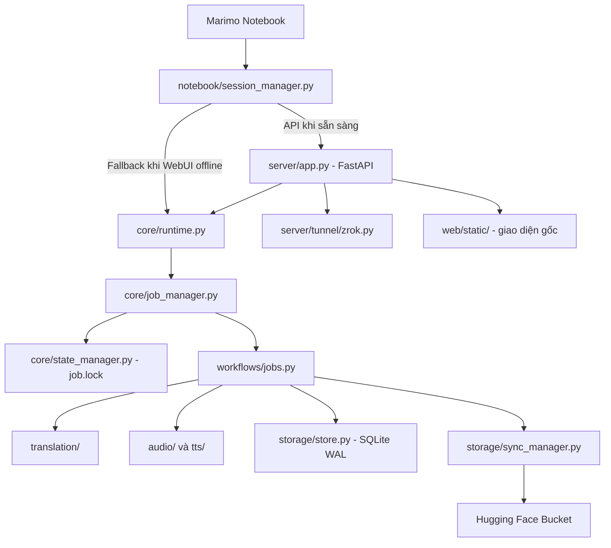

# NovelReader — kiến trúc module

Mục tiêu: MoLab/Marimo làm bảng điều khiển, **một tiến trình giữ quyền chạy job** trên mỗi SQLite, WebUI FastAPI phục vụ HTTP qua tunnel, và Hugging Face lưu kết quả/checkpoint.



## Cây thành phần chính

```text
NovelReader_Translate/
├── NovelReader_Molab.py        # Giao diện notebook và runtime launcher
├── NovelReader_Colab.ipynb    # Notebook Colab cũ; cần tái đóng gói sau khi pull
├── main.py                    # Uvicorn import ổn định
├── core/
│   ├── config.py              # Cờ môi trường
│   ├── state_manager.py       # job.lock, job_state.json
│   ├── job_manager.py         # ManagedJob độc quyền
│   └── runtime.py             # Store/Job singleton
├── notebook/
│   ├── bootstrap.py
│   ├── gpu_manager.py
│   ├── model_loader.py
│   └── session_manager.py     # HTTP client cho Marimo
├── server/
│   ├── app.py
│   ├── api/                   # Đăng ký web/routes
│   ├── auth/access.py
│   └── tunnel/zrok.py
├── translation/               # Giữ các engine và core hiện có
├── audio/                     # Piper/VieNeu/audio processor
├── tts/                       # Giọng/model/pipeline TTS
├── workflows/
│   ├── jobs.py
│   └── audio_queue.py
├── storage/
│   ├── store.py               # SQLite
│   ├── huggingface_service.py
│   ├── cloud_settings.py
│   ├── checkpoints.py
│   └── sync_manager.py        # Đồng bộ định kỳ/cuối tác vụ
├── monitoring/
│   ├── resources.py
│   ├── tasks.py
│   └── logger.py
├── web/
│   ├── static/                # WebUI không thay đổi
│   ├── routes/                # API tương thích
│   ├── runtime.py             # Alias core.runtime
│   ├── application.py         # Alias server.app
│   └── access.py              # Alias server.auth.access
└── tests/
```

## Nguyên tắc runtime

1. Các nút Marimo gọi API FastAPI khi server sẵn sàng. Nếu WebUI không chạy thì vẫn có thể chạy local, nhưng `job.lock` ngăn chạy hai job trên cùng DB.
2. Khi một worker đang có khóa, Store được mở mà không phục hồi trạng thái chương dở dang. Khi không còn worker, Store có thể phục hồi các trạng thái `translating`/`generating` về chờ để tiếp tục.
3. `job_state.json` chỉ chứa số lượng/trạng thái job; không chứa truyện, token hay audio.
4. `storage/sync_manager.py` tạo checkpoint từng mốc số chương (hoặc mốc thời gian được kiểm tra khi chương hoàn thành) và tạo thêm checkpoint cuối. Bản định kỳ không kèm audio.
5. Token Hugging Face/zrok chỉ điền trực tiếp vào **bản notebook cá nhân riêng tư**; mã nguồn GitHub công khai giữ vị trí trống.

## Kiểm thử và vận hành

- `python -m pytest tests/test_architecture_refactor.py tests/test_cloud_sync_manager.py tests/test_api.py tests/test_jobs.py -q`
- `python -m uvicorn main:app --host 127.0.0.1 --port 8000 --workers 1`
- `python scripts/package_notebooks.py` để dựng lại notebook/ZIP phân phối sau khi pull.
- Đổi code bằng cách mở sandbox MoLab mới hoặc cập nhật checkout cũ *khi không còn job chạy*. Không xóa `data/` hay `output_*/` vì đó là checkpoint thực.
